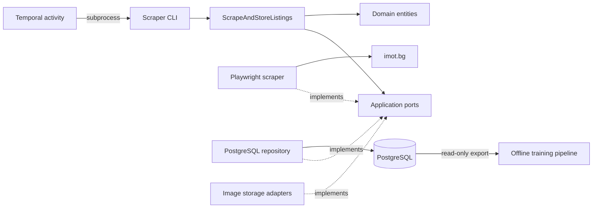

# Architecture and data model

## Component boundaries

The application follows a ports-and-adapters structure. Domain objects express
listing data and rules. Application use cases depend on abstract ports.
Infrastructure implements those ports; interface entry points construct the
concrete dependencies.

The image storage adapter is constructed by the CLI but is currently not invoked
by the use case. The diagram shows component relationships, not enabled features.

| Location | Responsibility |
|---|---|
| `src/apartment_finder/domain/` | Listing identity, money, status, search scope, and entities |
| `src/apartment_finder/application/` | Scraping orchestration and abstract integration ports |
| `src/apartment_finder/infrastructure/` | Browser, persistence, storage, and Temporal adapters |
| `src/apartment_finder/interface/` | CLI parsing, dependency composition, and logging setup |
| `db_migrations/` | Alembic schema history |
| `training/` | Export, annotation, encoder training, evaluation, and prediction |
| `tests/` | Unit tests and PostgreSQL integration tests |

## Scrape lifecycle

The [scrape use case](../src/apartment_finder/application/use_cases/scrape_and_store_listings.py)
performs the following operations:

1. Discover listing references from the requested search pages.
2. Mark discovered identities as active and refresh their last-seen timestamp.
3. Filter discovered references against stored identities and prices.
4. Find stored listings absent from discovery that match the source and search
   scope, and queue their detail URLs for rechecking.
5. Scrape the union of new candidates and recheck URLs with shared workers and
   request pacing. Results may arrive in any order.
6. Refresh status for successful rechecks. Record failed rechecks as unreachable
   or expired. An identity mismatch also counts as a failed recheck.
7. Save successfully parsed new identities and return discovery, save, duplicate,
   and failure counts.

A search returning HTTP 404 or 410 ends the run with `search_not_found` and no
repository mutations. Other discovery exceptions propagate. Individual detail
failures are counted and logged; they do not necessarily fail the process.
Rechecks contribute to failure counts, so those counts are not limited to the
number of listings discovered in this run.

Request delay is shared among workers within one scraper instance. It is not a
rate limit across separate processes or deployments.

## Availability lifecycle

| Observation | Status | Last-seen timestamp |
|---|---|---|
| Identity appears in search results | `active` | Updated |
| Missing identity successfully rechecked | `active` | Updated |
| Recheck fails; last seen at most three days ago | `unreachable` | Preserved |
| Recheck fails; last seen more than three days ago | `expired` | Preserved |

Expiration is evaluated during scraping, not by a separate timer. Unreachable
and expired records remain eligible for rechecking. Absence from one search page
alone does not expire a listing.

Search scope currently matches area slugs and room counts. Empty scope fields
are unrestricted. City and transaction type are not part of scope matching, so
broad or partial searches can trigger additional detail requests.

## Persistence model

The [SQLAlchemy models](../src/apartment_finder/infrastructure/persistence/models.py)
and [migration history](../db_migrations/versions/) define the schema.

| Table | Purpose | Important constraints |
|---|---|---|
| `apartments` | Foundation for grouping listings for one apartment | UUID primary key |
| `listings` | Source identity, URL, price, property attributes, description, timestamps, status | UUID primary key; unique `(source, external_id, price_amount)`; optional apartment foreign key |
| `listing_images` | Ordered image storage references | Listing foreign key; unique `(listing_id, sequence)` |

Domain listing identity is `(source, external_id)`; the database UUID is an
internal row identifier. Prices carry a currency and an amount. Listing records
also include location, area, floor information, agency, and contact details.

Repository methods use separate transactions. A scrape is not one atomic
transaction: earlier successful writes can remain after a later failure.

## Known limitations

- The save path skips an identity that already exists, even when discovery found
  a different price. The schema does not imply working price-history capture.
- Successful rechecks refresh availability, not listing details.
- Stored listings are loaded for rechecking; this is not a bounded database
  query optimized for large datasets.
- Concurrent independent scrape runs have no application-level coordination to
  prevent duplicate insert races.
- Image downloading is disabled in the use case, and image references are not
  populated by the listing repository's save path.
- Apartment grouping, preference matching, and notifications are not complete
  application workflows.
- The trained encoder extracts POI names and categories only. It does not yet
  extract distances or run automatically during scraping.
