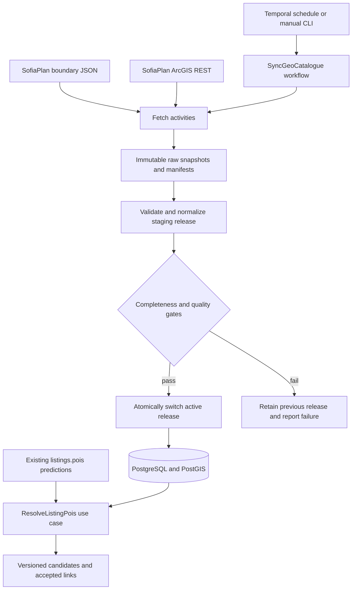

# SofiaPlan boundaries and POI reference catalogue

Update: [GIS-Sofia official exports](gis-sofia-open-data.md) now provide verified
street/sidewalk polygons with names and a street-name history table. Prefer that
source for surface geometry; earlier iSofMap limitations below remain specific
to its tested WFS responses.

Status: target architecture. An initial importer, PostGIS migration and coordinate
lookup are now implemented; see [geospatial operations](geospatial-operations.md).
Description-based resolution, reference imports and review/calibration are now
implemented; see [resolver operations](location-resolver-operations.md). Scheduling
remains proposed. Source inspection date: 2026-11-08.

## Recommendation

Add a reference-data pipeline alongside listing scraping and model enrichment.
Read the public JSON services used by SofiaPlan's maps, retain immutable source
snapshots, validate and normalize into PostgreSQL with PostGIS, then publish a
validated catalogue release. Resolve extracted listing mentions against that
release in a separate use case. Preserve the original model predictions.

Use full snapshots initially: the inspected sources contain 564 boundaries and
60,494 POI records across seven thematic point layers. This size makes a complete
weekly POI refresh and monthly boundary refresh practical starting defaults;
measure duration and adjust. Downloads do not establish how recently the source
itself was surveyed.



## Verified source contracts

### Planning unit boundaries

The [boundary application](https://ge.sofiaplan.bg/) describes its units as
territorial information units representing neighbourhoods, settlements, or
special zones. They are not necessarily imot.bg neighbourhoods or administrative
districts. Do not equate these identifiers or merge by name.

The application's [JavaScript](https://ge.sofiaplan.bg/main.js) calls:

- [All units](https://ge.sofiaplan.bg/api.php?request=get_city_units): GeoJSON
  FeatureCollection; inspected response has 564 features, with `properties.id`
  (string), `properties.name`, and polygon geometry.
- `api.php?request=get_city_unit_data&city_unit_id=<id>`: optional passport
  indicators, separate from the boundary geometry.
- `api.php?request=get_city_unit_attribute_groups` and
  `api.php?request=get_city_unit_attribute_subgroups`: optional indicator metadata.

The inspected GeoJSON has no explicit `crs`; coordinates match Sofia longitude
and latitude, as consumed by Leaflet. Treat it as WGS84 GeoJSON, validate bounds
and axis order, and reject an unexpected coordinate range. Normalize Polygon and
MultiPolygon to `geometry(MultiPolygon,4326)`. Preserve the raw geometry before
any repair. Passport indicators are outside the first implementation scope.

### POIs

The supplied application resolves through this discovery chain:

1. [Application item data](https://gis.sofiaplan.bg/portal/sharing/rest/content/items/970ce03c7b1a4f279d1fb456e0a8714c/data?f=json).
2. Its `map.itemId` is currently `c621fb1d1d3e4c228c77326bcbcc31bb`;
   [web-map data](https://gis.sofiaplan.bg/portal/sharing/rest/content/items/c621fb1d1d3e4c228c77326bcbcc31bb/data?f=json)
   lists the operational services.
3. [POI MapServer](https://gis.sofiaplan.bg/server/rest/services/poi/poi/MapServer?f=pjson).

Store and recheck this chain; unexpected changes require a manifest update,
rather than silently following an arbitrary new host or replacing production.
The administrative boundary service in this web map is a separate dataset from
the planning units above.

| Point layer ID | Theme | Inspected count |
|---|---|---:|
| 1 | Transport infrastructure | 2,032 |
| 4 | Green system and sport | 3,505 |
| 7 | Culture, recreation and tourism | 698 |
| 10 | Administration and offices | 1,497 |
| 13 | Social infrastructure, including health and education | 7,367 |
| 16 | Science and innovation | 246 |
| 19 | Economy, including retail and restaurants | 45,149 |

Exclude paired layers `2,5,8,11,14,17,20`, labelled `клъстеризиране`;
these are alternative map presentations, not additional POIs. Assert the selected
layer ID, parent theme, fields, and geometry type on each run.

Inspected fields include `objectid` (OID), `idfkod` (classification code),
`function`, `tradename`, `activity`, `address`, `source`, `memo`, `date`, and
`orig_fid`. Some layers also expose `idsource`, `modified_at`, and `modified_by`.
`idfkod` is NOT a feature identifier. No globally stable feature identifier was
verified. Use `(source_dataset, layer_id, objectid)` as an identity within a
source generation; detect service republishing and reconcile identities before
carrying accepted links forward.

The service reports native SRID **7801**, Query capability, JSON/GeoJSON output,
pagination, and a 2,000-record maximum. Request `outSR=4326`; do not label native
coordinates as 4326. `returnIdsOnly=true` and `returnCountOnly=true` were tested
on all seven point layers and returned matching counts.

## Align source classifications with the existing model

Keep `domain/poi.py::PoiCategory` as the application taxonomy. Put source rules
in a versioned JSON manifest with layer, code, expected function labels,
canonical category, inclusion decision, and mapping version. The observed
`idfkod`/`function` pairs below are initial rules, not an exhaustive validated
mapping. Validate all distinct pairs during commissioning.

| Existing category | Observed source rule | Qualification |
|---|---|---|
| `airport` | layer 1, `1.1.1` Аерогара | May identify terminal points rather than an airport footprint |
| `park` | layer 4, `2.1.1`, `2.1.2`, `2.1.3` | Park/garden points; not park boundaries or entrances |
| `gym` | layer 4, `2.3.2` Фитнес зали | Other sport classes remain separate |
| `sports_facility` | layer 4, selected halls, pools, stadiums, pitches | Enumerate approved codes; do not map every `2.*` code |
| `bank` | layer 10, `4.4` | Payment counters in layer 1 are not automatically banks |
| `school` | layer 13, `5.2.2`, `5.2.3`, `5.2.4` | Avoid generic education and language-school records |
| `kindergarten` | layer 13, `5.4.2`, `5.4.3` | Keep nurseries (`5.4.1`) distinct pending a product decision |
| `hospital` | layer 13, `5.1.3` | Do not include every medical practice |
| `medical_center` | layer 13, `5.1.1`, `5.1.2` | Other medical subclasses need explicit decisions |
| `university` | layer 16, `6.1` | Includes colleges; keep source subtype |
| `shopping_mall` | layer 19, `7.4.5` | Includes shopping complexes |
| `supermarket` | layer 19, `7.4.2` | `7.4.3` also contains IKEA/DIY stores, so needs per-record classification |
| `market` | layer 19, `7.4.4` | Preserve original names |
| `restaurant` | layer 19, `7.5.1` | Fast food is a separate source code; decide explicitly |

No explicit pharmacy or metro/bus/tram-stop classification appeared in the
inspected distinct pairs. `boulevard`, `street`, and `ring_road` need line
geometry from another source. Do not reinterpret bus terminals, ticket offices,
or drugstores (`Дрогерии`) as those missing categories. Layer 7 mainly contains
categories outside the current taxonomy; retain its raw snapshot and exclude
from matching unless a reviewed `other` rule applies.

Unknown codes, mismatched function labels, blank names, and placeholders such as
`---` remain auditable but ineligible for automatic matching. A code is not
always sufficient: inspected layer 13 includes the same code with conflicting
function labels. Track the unmapped and conflicting counts by category.

Street lines and address points were subsequently retrieved from iSofMap; see
[iSofMap discovery and saved samples](isofmap-street-discovery.md) for verified
layers, coordinate caveats, and unresolved bulk-update guarantees.

Add separate adapters later for official transport stops/routes and road
geometry; evaluate OpenStreetMap for remaining gaps. Provider coverage,
licensing, stable IDs, and freshness must be verified before enabling them.
Retain both SofiaPlan attribution and its per-feature upstream `source`; the
inspected data includes OSM-derived records. Public query access alone does not
establish redistribution rights.

## Reliable extraction and update protocol

1. Acquire one database lease per catalogue, with expiry and ownership token.
   Temporal overlap prevention helps scheduled runs; the lease also protects
   manual runs and publication. Record a run ID and manifest version.
2. Fetch application/service/layer metadata and classification pairs. Validate
   expected hosts, HTTPS, geometry type, OID field (discover `esriFieldTypeOID`),
   required fields, and query capabilities. Handle ArcGIS JSON `error` objects
   even when HTTP status is 200.
3. Download the complete boundary response and enumerate POI object IDs per
   selected layer using `where=1=1&returnIdsOnly=true&f=json`. Persist the ID set.
   Fetch those IDs in sorted batches, initially 500, with `objectIds=...`,
   `outFields=*`, `returnGeometry=true`, `outSR=4326`, `f=json`. IDs fit bounded
   GET URLs at this batch size; enforce a URL length limit and reduce if needed.
   Follow the actual service method support rather than assuming POST works.
4. Require every requested ID exactly once, no unexpected IDs, non-null geometry,
   and no `exceededTransferLimit`. Split a limited batch and retry. If ID
   enumeration becomes unavailable, use capability-checked ordered pagination
   with exact ID/count reconciliation; never assume the first page is complete.
5. Enumerate IDs/counts again after download. Retry a layer if membership changed.
   This detects insert/delete drift, but cannot prove attributes were unchanged
   during extraction. Recheck edit markers where available; record this weaker
   consistency when the provider offers no historic snapshot support.
6. Retain compressed raw responses plus metadata, requested IDs, timestamps,
   request parameters, checksums, row counts, and validation report. Use existing
   object storage adapters or a persistent local volume; store URI and hash in
   PostgreSQL. Never put large responses into Temporal workflow history.
7. Normalize into an unpublished release. Validate finite coordinates, Sofia
   extent, IDs, geometry validity, and source category rules. Preserve raw text;
   normalize Unicode, whitespace, case, Bulgarian abbreviations, and aliases in
   separate fields. Flag mojibake rather than guessing a correction.
8. Gate publication on complete selected layers, unique identities, valid
   geometries, expected coverage, and configured count/change thresholds.
   Treat 564 as the observed boundary baseline, not a permanent invariant.
   Quarantine invalid features and fail publication if that makes the selected
   dataset incomplete; accepting exceptions must be explicit in the manifest.
9. In one short transaction, verify lease ownership, mark the release validated,
   and change the active-release pointer. Readers pin the release ID for the
   duration of a request/job. A failed layer leaves the entire old release active.
10. Emit counts, change totals, unknown categories, missing names, source age,
    duration, and last successful publication. Reprocessing the same raw snapshot
    and mapping version must be idempotent.

Use timeouts, bounded response sizes, limited concurrency (start with two), and
bounded exponential backoff with jitter for timeouts, 429 and transient 5xx;
honour Retry-After. Do not retry permanent schema errors indefinitely. Enforce
host allowlists on redirects as well as initial URLs; service URLs are operator
configuration, not arbitrary listing input.

Full snapshots naturally capture deletions. Absence means removed from this
release only after a complete successful extraction; retain prior releases and
links. Do not hard-delete canonical entities. If `objectid` values are reassigned,
quarantine the suspicious generation instead of updating old identities in place.

Use ETag/Last-Modified for conditional downloads only when actually supplied and
validated for that resource. Do not use `date` as a change cursor. `modified_at`
exists on some layers but was not verified as a complete change log; incremental
updates and deletion detection are therefore deferred. Mapping-only updates
replay stored snapshots without another source download.

## PostgreSQL and PostGIS model

Use a separate `geo` schema in the existing PostgreSQL database. Enable PostGIS
in a migration using a provisioning role; the application role needs only normal
schema privileges. SQLAlchemy plus parameterized PostGIS SQL through existing
psycopg is sufficient initially; GeoAlchemy is optional. Use a PostGIS-enabled
database image and integration-test database before applying geometry migrations.

| Proposed table | Key data and constraints |
|---|---|
| `geo.source_dataset` | UUID, provider, service/layer key, allowed endpoint, source generation; unique provider/service/layer/generation |
| `geo.import_run` | UUID, state, manifest hash, mapping version, start/end, failure and validation reports |
| `geo.snapshot` | UUID, run/dataset FKs, raw URI/hash, metadata JSONB, source timestamps, expected/downloaded counts; unique run/dataset |
| `geo.release` | UUID, run FK, mapping version, state, created/published timestamps |
| `geo.release_snapshot` | Release/snapshot FKs; unique release/dataset; records the exact source inputs |
| `geo.catalogue_state` | One named catalogue row with active release FK; updated atomically |
| `geo.feature` | Stable internal UUID, dataset FK, external ID, feature kind; unique dataset/external ID |
| `geo.boundary_version` | Release/feature PK and FKs, source name/code, valid nonempty MultiPolygon 4326, attributes JSONB, content hash |
| `geo.poi_version` | Release/feature PK and FKs, source name, normalized name, category nullable, mapping status, Point 4326, address, attributes JSONB, content hash |
| `geo.poi_alias` | Release/feature FK, normalized alias, language, origin and review status; aliases may identify multiple branches |
| `geo.poi_boundary` | Release, POI and boundary feature FKs to the corresponding version rows; relation and method; unique release/POI/boundary/relation |
| `geo.listing_poi_resolution` | Listing FK, prediction hash, mention offsets/category, model version, release FK, resolver version, status, accepted feature FK nullable, candidate scores JSONB |

Require composite FKs on versioned references so a link cannot mix releases.
Constrain resolution status to matched/ambiguous/unmatched and require an
accepted feature exactly for matched status. Make resolution identity unique on
listing/prediction hash/mention offsets/release/resolver version. Include the
model version in the prediction hash input. Preserve extracted text and model
confidence separately from resolver score. Store an explanation for each candidate.

Create GiST indexes on both geometry columns and an expression GiST index on
`poi_version.geom::geography` for metric radius queries. Add B-tree indexes on
release/category and dataset/external ID. Add `pg_trgm` GIN indexes on normalized
names/aliases when fuzzy search is introduced. Check SRID, type, nonempty and
valid geometry; normalize Polygon to MultiPolygon before inserting boundaries.
Keep rejected input in snapshots/reports rather than weakening constraints.

Boundary membership uses `ST_Covers(boundary.geom, poi.geom)` so points on an
edge are included. Retain all candidates on shared edges; do not select an
arbitrary boundary. Polygon/line POIs from future providers need a separate
geometry model and `ST_Intersects`/overlap semantics, not centroid containment.
[PostGIS documents these boundary semantics](https://postgis.net/docs/ST_Covers.html).

Example radius query, with `:release_id`, `:category`, `:lon`, `:lat`, and
`:radius_m` supplied as validated bound parameters:

```sql
SELECT p.feature_id, p.name,
       ST_Distance(p.geom::geography, q.point::geography) AS distance_m
FROM geo.poi_version p
CROSS JOIN (
    SELECT ST_SetSRID(ST_MakePoint(:lon, :lat), 4326) AS point
) q
WHERE p.release_id = :release_id
  AND p.category = :category
  AND p.mapping_status = 'mapped'
  AND ST_DWithin(p.geom::geography, q.point::geography, :radius_m)
ORDER BY distance_m, p.feature_id;
```

The proposed `poi_version` field is `name` for the original source name.
Geography distances are metres, while 4326 geometry distances are degrees;
[PostGIS documents the distinction](https://postgis.net/docs/ST_DWithin.html).
A distance to a park's source point is not a distance to its entrance or perimeter.

## Resolve listing mentions without changing extraction

The current encoder returns names, categories, offsets, and confidence through
`infrastructure/poi/http_predictor.py`. Migration `0009` stores those predictions
and their model version/description hash on `listings`. The richer teacher schema
in `domain/poi.py` also has evidence and distances; do not assume the production
encoder extracts those fields.

Resolve category-compatible exact aliases first, then normalized names and
reviewed fuzzy candidates. Rank using independent listing location, address,
verified neighbourhood crosswalks, school numbers, and brand/branch information.
Preserve original and transliterated aliases separately. Require a calibrated
threshold and a clear margin over the second candidate; otherwise abstain.

Examples:

- `33 СУ`: school number plus reviewed aliases can identify a school; retain the
  evidence span and candidate explanation.
- `Лидл`: a brand with multiple branches; remain ambiguous without independent
  location evidence. A nearest candidate is not automatically the correct branch.
- `автобус 204`: a route mention, even if the current extraction category says
  `bus_stop`; do not attach it to one stop. Add mention kind route/place/brand to
  resolver output and later a route-to-stop reference model.
- `Южен парк`: matching the park's catalogue point does not justify assigning the
  listing to that point, its boundary unit, or a precise distance.

Use validated coordinates, when available, for listing-to-boundary assignment.
An imot.bg area name alone is a separate, potentially many-to-many crosswalk
with provenance and confidence. Store listing location method and uncertainty;
no precise geocoding workflow is currently established by this design.
POI mentions can constrain an approximate search area later, but that is a
separate inference with uncertainty, not an address observation.

Re-resolve when description/predictions, model version, resolver version, or
catalogue release changes. Before writing a match, compare the listing's current
prediction fingerprint in the transaction; stale work must not replace a result
for newer text. Preserve historical resolutions for audit. Pin releases during
jobs and protect referenced releases from retention cleanup.

## Fit with the repository

Keep the existing ports-and-adapters direction:

- `domain/geo.py`: reference identities, source features, mapping and resolution
  rules; no HTTP, SQLAlchemy, or Temporal imports.
- `application/ports.py`: boundary/POI source, snapshot storage, catalogue
  repository, and resolver repository protocols.
- `application/use_cases/sync_geo_catalogue.py`: extraction orchestration,
  validation, normalization, staging and publication through ports.
- `application/use_cases/resolve_listing_pois.py`: resolve stored mentions;
  independent of model inference and source downloading.
- `infrastructure/geo/`: GeoJSON and ArcGIS adapters, versioned source manifest,
  category rules and PostgreSQL/PostGIS repository implementation.
- `interface/geo_cli.py`: proposed `inspect`, `sync --dry-run`, `sync`,
  `replay --snapshot`, `activate --release`, and `resolve` commands. These are
  design examples, not commands currently available in the package.
- `infrastructure/temporal/`: separate `SyncGeoCatalogue` and
  `ResolveListingPois` workflows and activities, registered in worker composition.

Add a small serializable `GeoSyncRequest` to `temporal/contracts.py` at
implementation time: catalogue/source keys, manifest version, dry-run flag, and
bounded execution limits. Pass run/snapshot/release IDs between activities;
validate requests using the existing contract pattern. Network and database I/O
belong in activities, never workflow code. Activities heartbeat batch progress
and resume idempotently from stored snapshots; permanent validation failures are
non-retryable. Prefer a separate `apartment-finder-geo` task queue to isolate
reference imports. Worker and CLI registration must accompany that queue.

Keep listing scrape/model enrichment schedules independent. Successful catalogue
publication can enqueue bounded resolver batches; the existing enrichment path
can also enqueue newly predicted listings. Neither path should require a live
SofiaPlan request. For a consistent resolver batch, pin the release at start.

## Delivery and acceptance

1. Implement read-only discovery and extraction with recorded fixtures, a reviewed
   manifest, raw snapshots, and a completeness report. Verify source terms and
   all category mappings. No production publication yet.
2. Add PostGIS migrations and repositories; import a release and exercise dry-run,
   publish, replay, and rollback. Retain the prior active release.
3. Add scheduling, leases, bounded retries, heartbeat recovery, and freshness
   reporting. Start with weekly POIs and monthly boundaries, plus manual refresh.
4. Add resolver candidates and abstention, evaluate against reviewed listing
   mentions, then enable accepted links. Fill transit/pharmacy/road gaps through
   independently validated providers.

Required tests at implementation time:

- Unit fixtures: more than 2,000 features, truncated batches, duplicate/missing
  IDs, HTTP-200 ArcGIS errors, membership drift, rate limits, schema changes,
  unknown/conflicting categories, SRID conversion and axis order, placeholders,
  malformed geometry, route mentions, and ambiguous brand names.
- PostGIS integration: geometry constraints, inside/outside/shared-edge points,
  metric radius queries, cross-release FKs, concurrent publication, lease expiry,
  failed import preserving active data, idempotent replay, source deletions,
  rollback and stale-prediction write rejection.
- One opt-in live smoke check: source metadata and a tiny query, never a required
  network dependency for the normal test suite. Measure full import duration and
  examine query plans before selecting final batch sizes and schedules.

Use the existing lint and test workflow for implementation changes. This proposal
itself changes documentation only. ArcGIS extraction semantics are specified in
[Esri's Map Service Layer Query reference](https://developers.arcgis.com/rest/services-reference/enterprise/query-map-service-layer/).
